# «Пара» — цифровой деканат. Отчёт о процессе ИИ-разработки

**Команда:** Ермаков Ярослав — один человек (github: vertaler3). **Сайт:** https://para-student.ru. **Дата:** 21.11.2026. Дедлайн подачи — 22.11 23:59 (контекст задания).

Отчёт описывает и продукт, и процесс: кто что делал — человек и агенты, какие промпты ставились, что ловилось на приёмке. Промпты §3 приведены в том объёме, в каком их сохранил журнал (степень дословности — примечание в конце §3; фиксация по ходу работы — правило AGENTS.md §5.7).

**Обозначения и источники.** Э1–Э11 — этапы плана (05 §3): Э1 каркас и вход, Э2 профиль, Э3 расписание, Э4 успеваемость, Э5 заявки + PDF, Э5а бронь аудиторий, Э6 уведомления, Э6а люди/зачётка/рейтинг, Э6б библиотека/столовая/карта, Э7 фронтенд («Батчи 1–4» — четыре группы экранов вёрстки), Э8 безопасность, Э9 деплой, Э10 ручные проверки, Э11 документы. Р-N — записи журнала решений docs/decisions.md («контекст → варианты → выбор → причина»; например, Р-30 — пакет решений владельца 13.11 о VPS и срезах объёма, Р-36 — ассистент). 01–05 — документы пакета решений в docs/ (продукт, техника, дизайн, план работы с ИИ), 04 — обзор аналогов. С1–С8 — сквозные демо-сценарии (01 §3), 5.1–5.19 — реестр идей (01 §5). «Гейт» — внешний приёмочный скрипт владельца (docker compose down -v → up --build + чек-сценарии); «том», «пересев/сидирование» — Docker-том с БД и повторная загрузка демо-фикстур; «проба свежести» — машиночитаемый маркер версии сборки в ответе сервера; «CSP-шаблоны» — шаблонный язык Drogon (не Content-Security-Policy — заголовок безопасности из §5). Ссылки на строки задания даны по цитатам в docs/02 и docs/05 и по ответам владельца — сам файл задания в репозиторий не входит, проверить номера строк по нему нельзя. Доказательная база отчёта — журналы docs/agents-log, docs/decisions.md, AGENTS.md, пакет 01–05 и весь код — лежит в репозитории https://github.com/vertaler3/para, публично доступном на момент сборки отчёта (страница репозитория — HTTP 200, GitHub API — «private»: false; contents docs/agents-log и docs/decisions.md отдаются анонимно — проверено curl в этой сессии). Все ссылки вида «02 §5.2», «Р-30», «журнал…» проверяются в нём по путям из отчёта; ветки main и final_fixes_v1 видны публично. Метрики процесса (токены, часы, подписки, состав команды) — самооценка владельца из интервью 21.11: в репозитории их нет, методика подсчёта не раскрыта, иных источников нет.

## §1. Проблема и выбор разделов

Учебная жизнь студента уже «цифровая», но раздроблена минимум на пять мест (docs/01-продуктовое-решение.md §1, строки 21–37): расписание — сайт/PDF или чат группы («перенос узнаёшь от одногруппника»); оценки — отдельная ведомость («таблица цифр без картины»); справки — очередь в деканат в часы приёма плюс второй визит «узнать, готово ли»; объявления — Telegram-чаты, почта, доски («важное тонет между мемами»); дедлайны — «в голове, узнаёшь накануне». Цена дня по персонам (01 §2; оценка команды при проектировании персон, не полевой опрос): 15–30 минут только на сборку картины дня, риск 1–2 пропущенных переносов в месяц, полпары на визит в деканат; дорого и деканату — однотипные вопросы и бумажный ввод (01 §1).

Вывод (01 §1): студенту нужно не «ещё одно приложение», а меньше работы — собрать разрозненное в одну картину, приоритизировать её, превратить бумажный процесс в трекинг «как у доставки» и доводить изменения push-ом. Отсюда выбор разделов: обязательное ядро задания — «вход и профиль, расписание, успеваемость, заявки, уведомления» (задание, строки 29–33; цитата в 05 §1) — доведено до защищённого и протестированного состояния, а главным экраном стал «Сейчас важно», отвечающий на вопрос «что мне делать сегодня» (01, «Решение в шести строках»: паттерн «собирать, а не заменять» — вывод из uPortal). Сознательно не копировали LMS (Moodle/Canvas): «жизнь студента» — справки, очередь, объявления — в них размазана (01 §1, «Вывод для продукта»).

Ключевые решения — продукт-гипотезы из обзора open-source-аналогов (01, строки 7–12; обзор — docs/04): заявка — конечный автомат с таймлайном (Easy!Appointments/OpenEduCat); перенос пары — событие первого класса «было → стало» + push (UniTime/FET); приватность — в модели данных, на сервере (RosarioSIS/Gibbon); mobile-first от 360 px (RosarioSIS/openSIS-Classic/ILIAS).

## §2. Перечень ИИ-инструментов, IDE и сервисов

Работа шла конвейером специализированных агентов, а не «одним чатом» (05 §4.1): исследователь (лицензии зависимостей — decisions.md), архитектор/планировщик (Э1, Э5, Э6), кодер-бэкенд (Э1–Э6, Э8), кодер-вёрстка (Э2–Э7), тест-инженер, хранитель AGENTS.md, ревьюер-скептик (каждый дифф), дизайн/контент, документатор, факт-чекер. Агентам запрещено выдумывать API — контекст включает фиксированные версии и реальные сигнатуры (05 §4.1); документы пакета решений — промпты для агентов, человек — постановщик и приёмщик.

| Инструмент / модель | Подписка и режим | Роль на этапах |
|---|---|---|
| **ZCode + GLM-5.3 / GLM-5.3-Flash** | effort: max; подписка GLM Coding Pro V3; израсходовано ~750 млн токенов GLM-5.3 и ~900 млн GLM-5.3-Flash (ответ владельца, п.1) | Изначальное планирование и весь бэкенд-код: Э1–Э6б, фикстуры v2, э7-be, 5.17, 5.18; все роли конвейера; групповые workflow-машины багфиксов вёрстки (журнал docs/agents-log/батч1-glm.md — «Групповая машина багфиксов вёрстки»). Журналы Э1 фиксируют: «ИИ-агент „сборщик каркаса“ (GLM, ZCode dynamic-workflow)» (2026-11-05-этап1-шаги-1-2-каркас-и-cmake.md:5) |
| **GPT 6 Astra Ultra** | подписка Pro (ответ владельца) | Дизайн: 41 HTML-страница эталона v3 «Пара — копия.html» (3 355 717 Б — журнал 2026-11-18-дизайн-v3-каркас.md); создан 14–17.11 — окно без git-коммитов (git log по датам). Роль «дизайн/контент» |
| **Claude Opus 5.5** | effort: max; режим ultracode; подписка Max 5x (ответ владельца) | Финальная перестройка дизайна fe_rebuild (18–19.11), ИИ-ассистент 5.19 (20.11), часть фиксов (21.11); метод «команда моделей»: исполнитель Claude Code, советник и checker (журналы 2026-11-20-ai-ассистент.md:3, 2026-11-19-фиксы-владельца.md:35 «Ревью checker (opus)») |
| **YandexGPT** (OpenAI-совместимый API) | облако владельца; ключи ASSISTANT_* в .env (Р-36) | Не инструмент разработки, а модель внутри продукта: движок ассистента 5.19 |
| **Запуск агентов** | workflow в ZCode, ultracode в Claude (ответ владельца, п.2) | PR-конвейер GitHub #1–#6 (git log --merges). Приёмочный гейт этапов — внешний скрипт владельца; агент compose не гоняет (AGENTS.md §6) |

Проверяемые прокси масштаба — 255 коммитов за 05–21.11, 89 журналов ИИ-сессий, 25 этапных скриншотов (§4).

## §3. Ключевые промпты по этапам

Ниже 15 промптов, покрывающих путь от каркаса до инфраструктуры рядом с деплоем: каркас и закрытие Э1, ядро бэкенда (OwnershipGuard, автомат заявки, PDF), два самых поучительных цикла правок по гейту (Э5, Э6), фикстуры v2, вёрстка, дизайн v3, обязательные 5.17/5.18. Все цитаты приведены в том объёме, в каком их сохранил журнал (89 файлов на ветке final_fixes_v1, подсчитано ls в этой сессии): большинство — дословно, часть — как «(суть)»/«Суть постановки» (полная запись, но не побайтовый оригинал), а для правок по гейту Э6 (3.8–3.9) журнал сохранил только вход — сводку гейта; это единственные два пункта, где исходная постановка не дошла. Детали — в примечании в конце раздела.

### 3.1. Э1: каркас репозитория и CMake-скаффолд
*Источник: docs/agents-log/2026-11-05-этап1-шаги-1-2-каркас-и-cmake.md*

> Выполни ТОЛЬКО шаги 1 и 2 Э1 из гайда. Репозиторий создаётся в папке para/ рабочей области — её сейчас нет, создай с нуля.
> Шаг 1 — репозиторий: 1. git init в para/ (ветка main), git remote add origin git@github.com:vertaler3/para.git. НЕ пушить (push — шаг 8, будущий). 2. Дерево — по 05 §2, но только каркас шагов 1–2: в корне para/ — README.md, AGENTS.md (копия корневого), LICENSE (MIT, © 2026 команда «Пара»), CMakeLists.txt, config.json, env.example, .gitignore (.env, /data/*.db, data/, ключи, build/, .DS_Store), .gitattributes. 3. Каталоги-заготовки с .gitkeep (без содержимого — будущие этапы): src/filters, src/services, src/models, src/utils, tests/unit, tests/integration, static/ (и его подпапки css, js, vendor, fonts, icons, img), views/, sql/migrations/, docs/agents-log, docs/screens, docs/decisions.md (файл с шапкой журнала «контекст → варианты → выбор → причина»). Файлы sql/fixtures.sql, deploy/, tools/, pwa/, .github/, static-содержимое и шаблоны views НЕ создавать — это будущее. 4. Копии в docs/: «решения/01…05» → para/docs/, «гайды/» → para/docs/гайды/. 5. README.md: бейдж «концепт для хакатона, данные вымышленные», стек, запуск в 3 команды, раздел «Демо-доступы жюри» с пометкой «появятся на шаге 6 Э1».
> Шаг 2 — CMake и скаффолд: 6. Эталон стиля: выполни в контейнере drogon_ctl create project (docker run --rm -v "$PWD/para:/gen" -w /gen drogonframework/drogon:1.9.14 drogon_ctl create project gen; …), перенеси из генерата структуру и стиль (main.cpp, контроллер, CMake), а лишние demo-файлы удали. Если контейнер не запустился — напиши каркас вручную по стилю drogon_ctl и укажи это в scaffoldSource. 7. CMakeLists.txt: cmake_minimum_required 3.20, C++20, find_package(Drogon CONFIG REQUIRED); цели para, para-tests, security_tests. Линковка: предпочти статические цели (Drogon::DrogonStatic, Trantor::TrantorStatic)… Решение и причину запиши в para/docs/decisions.md. 8. src/main.cpp — минимальный… БЕЗ миграций, фильтров, сессий (шаги 4–7). 9. src/controllers/HealthCtrl.{h,cpp} — тонкий контроллер: GET /healthz → HTTP 200 и тело «ok». 10. config.json — минимум без секретов: listener 0.0.0.0:8080, лог… 11. Цель para-tests: vendored doctest.hpp (одиночный заголовок; лицензию MIT проверь и запиши в docs/decisions.md) и один смок-тест… Цель security_tests: заглушка… Обе цели собираются. 12. Первый коммит… Проверка гайда: git status --porcelain в para/ пустой. Docker-файлы (Dockerfile, docker-compose.yml, .dockerignore) НЕ создавай — они отдельным заданием. [журнал: дословный промпт оркестратора, сокращена только преамбула «Прочитай AGENTS.md…» и повтор списка файлов]

**Что сделал агент:** коммит d4d4565 (39 файлов, git status чистый): дерево para/ по 05 §2, CMake-цели para/para-tests/security_tests со статической линковкой (Р-1), HealthCtrl /healthz, vendored doctest; в контейнере drogonframework/drogon:v1.9.14 — сборка exit 0, para-tests 1/1, смок /healthz → 200 «ok».

**Что поймали на приёмке и как исправили:** код принят как есть; первая же команда вскрыла расхождения постановки с фактом: тег образа drogonframework/drogon:1.9.14 не существует (валиден v1.9.14), «образ скачан заранее» не подтвердилось, неполный ldd|grep дал преждевременный вывод — урок «полный ldd» внесён в Р-4 (docs/decisions.md).

### 3.2. Э1: закрытие этапа — гейт с первого прогона (чистая сессия)
*Источник: docs/agents-log/2026-11-05-э1-закрытие-агентская-сессия.md*

> Прочитай AGENTS.md в корне рабочей области. Закрываем Э1 — сделай три вещи, каждую отдельным коммитом: 1. Пароль: перегенерируй хэши в sql/fixtures.sql для пароля «<значение старого демо-пароля — изъято по §5.2, см. примечание под цитатой>» (argon2id, t=2, m=19456, p=1, соль уникальная на аккаунт), проверь все 5 через argon2id_verify. Сам пароль в файлы и код не писать (§5.2) — обнови запись в docs/decisions.md: «значение передано владельцу в чате». 2. Формат ошибок: сейчас API отдаёт плоский {"error":"invalid_credentials"}, а 02 §5.1 требует вложенный {"error":{"code":"...","message":"..."}}. Приведи все ответы об ошибках к формату из 02 (или, если считаешь плоский лучше, задокументируй отклонение в docs/decisions.md — но не молчи). 3. Закрой этап: актуализируй README (реальные команды сборки/тестов/запуска), обнови AGENTS.md — раздел 4 «Команды» фактическими командами, раздел 6: «Э1 закрыт (шаги 1–9), следующий этап Э2»; раздел 8 по необходимости. Не трогай static/ и views/. После правок запусти docker compose --profile tests run --rm tests и смок-тест входа из гайда — покажи выводы и git log --oneline.

*(примечание к цитате: значение демо-пароля изъято по §5.2 — в репозитории, журналах и этом отчёте его нет; публикуется в комментарии к работе.)*

**Что сделал агент:** три коммита: 42ab5a1 — ротация демо-пароля (5 argon2id-хэшей с уникальными солями, проверены argon2id_verify, старый отозван → 401); d3bc367 — хелпер ApiError.h и 6 ответов в формате 02 §5.1; d984736 — README/AGENTS. Гейт закрытия зелёный с первого прогона: пересев users=5, идемпотентность restart 5→5, смок 200/401/429, ctest 2/2.

**Что поймали на приёмке и как исправили:** ничего — «ошибок, потребовавших правок, не зафиксировано» (журнал); 4 находки независимого ревью — все без mustFix; старый пароль в журнал не перенесён (сознательно, §5.2).

### 3.3. Э2: OwnershipGuard — серверная проверка владения для path-id
*Источник: docs/agents-log/2026-11-05-э2-шаг-1-ownership-guard.md*

> Прочитай AGENTS.md, гайд-бэкенд §4 (Э2), 02 §6.3. Выполни шаг 1 Э2: сервис src/services/OwnershipGuard.{h,cpp} — проверка владения «объект с user_id по сессии» (enum-результат Own/NotFound/Forbidden из (sessionUserId, таблица, id объекта) fetch-and-compare или из (sessionUserId, targetUserId) — выбрать по 02 §6.3 и описать в заголовке); правило код-ревью «контроллер с path-id обязан вызвать OwnershipGuard» зафиксировать в заголовке сервиса; юнит-тест в tests/unit (para-tests): своё → ok, чужое → Forbidden/403, несуществующее → NotFound/404, на временной SQLite, SQL параметрами; коммит «Э2: шаг 1 — OwnershipGuard (сервис + юнит-тесты ок/403/404)»

**Что сделал агент:** OwnershipGuard.{h,cpp}: одна check() fetch-and-compare (SELECT user_id параметром, switch-литералы таблиц без конкатенаций), вердикты Own/NotFound/Forbidden/Error (fail-closed), правило ревью в шапке; 4 кейса на временной SQLite через настоящий DbClient — 12/12, 147 утверждений.

**Что поймали на приёмке и как исправили:** на приёмке чисто; дефект пойман тестами до неё: двойной cb = std::move(cb) в цепочке `>>` → bad_function_call на error-пути (11/12 SIGABRT → после фикса 12/12); та же ловушка латентно в UserService Э1. Плюс неоднозначность const char* в DbClient::operator<< — поймана компиляцией.

### 3.4. Э5: AppWorkflow — конечный автомат заявки (матрица 16 переходов)
*Источник: docs/agents-log/2026-11-06-э5-шаг-1-appworkflow.md*

> Прочитай AGENTS.md в корне репозитория, гайд-бэкенд раздел 7 (Э5), 02 §4.1 (applications, application_events) и §5.2, а также 01 сценарии С2 и С7 (С7.6: после ответа студента статус возвращается „В работе" — матрица должна разрешать need_info → in_progress). Шаг 1 Э5 — автомат заявок: 1) Сервис src/services/AppWorkflow: матрица переходов (константа в src/models — по дереву 05 §2 „матрица переходов статусов"): submitted→accepted→in_progress→need_info|ready→issued; need_info→in_progress (С7.6); draft→submitted; отклонение/отмена — если 02/01 их предполагают (сверься). Недопустимый переход — ошибка, которую контроллер отдаёт как 409 в формате 02 §5.1. 2) Каждое применение перехода пишет строку в application_events (from_status, to_status, comment, author_id). 3) Юнит-тесты в tests/unit: ВСЕ валидные переходы матрицы (каждый применён и событие записано) + невалидные (например, submitted→issued, ready→in_progress) → ошибка перехода. 4) Коммит „Э5: шаг 1 — AppWorkflow: автомат статусов + application_events"

**Что сделал агент:** Applications.h: словарь 9 статусов дословно из CHECK DDL + матрица 16 пар + constexpr-предикат; AppWorkflow::apply() в drogon-транзакции с условным UPDATE и INSERT в application_events, InvalidTransition→409; тесты — все 16 переходов, С7.6-цикл draft→…→issued, перебор 65 невалидных пар — 47/47, 1671 утверждение.

**Что поймали на приёмке и как исправили:** чисто на приёмке; снято компилятором и тестами (std::atomic в лямбде → make_shared; *tx вне области захвата; DrogonDbException без using; doctest CHECK_FALSE(a&&b) «Expression Too Complex»). Семантика транзакций Drogon снята с заголовков образа, не по памяти.

### 3.5. Э5: PdfBuilder — PDF-справка со штампом «ДЕМО»
*Источник: docs/agents-log/2026-11-06-э5-шаг-4-pdf.md*

> Прочитай AGENTS.md (§5.4 — лицензии), гайд-бэкенд раздел 7 (Э5), 02 §5.2 (строка /v1/applications/{id}/pdf: 200 · 403 · 404 · 409 (ещё не готова)) и §8.1 (libharu v2.4.6 из исходников на build-слое). Шаг 4 Э5 — PDF: 1) Собери libharu v2.4.6 из исходников в build-стадии Dockerfile; лицензия zlib/libpng — проверь и запиши в docs/decisions.md вместе с источником. 2) TTF-шрифт с кириллицей (DejaVu Sans из fonts-dejavu-core в build-стадии → рантайм, или вендорь); лицензию шрифта — в decisions.md. 3) PdfBuilder: %PDF-, кириллица встроенным TTF, диагональный штамп «ДЕМО · вымышленные данные»; гарантируй детектируемый маркер штампа в СЫРЫХ байтах (напр. KEYWORDS как hex UTF-16BE) — верни stampMarker (проверь юнит-тестом: сохранить PDF во временный файл и найти маркер). 4) GET /v1/applications/{id}/pdf: OwnershipGuard (403/404) ДО проверки статуса; ready|issued → 200 + application/pdf; иначе 409. 5) Коммит „Э5: шаг 4 — PdfBuilder: PDF-справка со штампом ДЕМО"

**Что сделал агент:** libharu v2.4.6 из исходников с пином коммита в Dockerfile (Р-12), DejaVuSans.ttf → /opt/para/fonts, PdfBuilder (штамп 45° «ДЕМО · вымышленные данные · DEMO-FAKE-DATA», кириллица /FontFile2), PdfCtrl с guard ДО статуса (403/404/409/200); 3 кейса, 60/60, E2E 401/409/403/404/200 (84 869 байт, маркер в файле).

**Что поймали на приёмке и как исправили:** классическое «шаблон ждёт X — API отдаёт Y»: постановка ждала маркер KEYWORDS как hex UTF-16BE — libharu v2.4.6 пишет Info-литералы октал-эскейпами UTF-8, hex не находится; маркер переопределён на фактические байты (kStampMarker), способ в Р-12, охраняется тестом. Попутно сборкой пойманы -x c++ на .h и незахваченный userId.

### 3.6. Э5: правки по гейту раунд 1 — возврат «В работе» и штамп
*Источник: docs/agents-log/2026-11-06-э5-правки-по-гейту-раунд-1.md*

> Гейт Э5 нашёл проблемы (раунд 1): цепочка …"возвратВРаботу":false…,"pdfШтамп":false… Контекст: том пересоздан (down -v), фикстуры пересеяны: applications 1=Дина(in_progress), 2=Олег(submitted), 3=Марк(draft); dean.demo — staff. Сценарии: С2 — подача новой заявки (201, submitted, таймлайн, PDF 409 до готовности, PUT не-draft 409); С7 на заявке 1 — need_info (200) → сообщение Дины (201) → возврат in_progress (200) → ready → issued → PDF со штампом; недопустимый переход submitted→issued → 409; студент на /v1/staff/* → 403; чужой id → 403; несуществующий → 404. Найди причины, исправь, коммит «Э5: правки по гейту, раунд 1»

**Что сделал агент:** воспроизвёл сценарий гейта дословно (свежая БД, сессии прямым INSERT) — возврат работает; kStampMarker = "DEMO-FAKE-DATA", поле application_status в 201-ответе messages; тесты обновлены — 60/60 (1974), цепочка гейта E2E зелёная.

**Что поймали на приёмке и как исправили:** два недопонимания формы ответа: код возврата need_info→in_progress работал, но гейт читал отсутствующее поле — «шаблон ждёт статус заявки после сообщения — API отдавал только объект события» (фикс — application_status в 201); октал-эскейпы «ДЕМО» находятся только сырым поиском — канонический машинный маркер DEMO-FAKE-DATA.

### 3.7. Э5: правки по гейту раунд 2 — ложная тревога: гейт на старом бинаре
*Источник: docs/agents-log/2026-11-06-э5-правки-по-гейту-раунд-2.md*

> Гейт Э5 нашёл проблемы (раунд 2): та же цепочка с `"возвратВРаботу":false` и `"pdfШтамп":false` (остальное true). Контекст — том пересоздан, фикстуры пересеяны (1=Дина in_progress, 2=Олег submitted, 3=Марк draft); dean.demo — staff. Найди причины, исправь, коммит „Э5: правки по гейту, раунд 2“

**Что сделал агент:** доказал свежим E2E, что правки раунда 1 (42be376) работают, а сводка 1:1 повторяет раунд 1 → гейт гонял старый образ; revealKeywordsUtf8 (/Keywords сырыми UTF-8 байтами на месте, xref не сдвигается), HPDF_COMP_NONE, /Subject para-e5-gate-r2, алиас status; 60/60, 1983 утверждения.

**Что поймали на приёмке и как исправили:** ложная тревога: оба false идентичны раунду 1 при исправном коде — гейт шёл на бинаре до 42be376. Ответ — не слепые правки, а машиночитаемая проба свежести /Subject para-e5-gate-r2: нет строки в PDF — проверка по старой сборке.

### 3.8. Э6: правки по гейту раунд 1 — гейт ищет сырую кириллицу, API отдаёт \uXXXX
*Источник: docs/agents-log/2026-11-07-э6-правки-по-гейту-раунд-1.md. Промпт правочной сессии журнал отдельно не выписывал — вход зафиксирован строкой «Сводка гейта (раунд 1)», приведена дословно:*

> «true — входы, дельтаАни 1, дельтаОлега 1, deepLink, ws101, wsБезCookie, дашбордСтудент403, объявление, безPush; false — перенос, дашборд, вЛента; том пересоздан (down -v), фикстуры пересеяны, anya=1/oleg=2 (группа 1-ФМО), dean=5.» — задача правочной сессии: найти причины false, исправить, закоммитить.

**Что сделал агент:** диагностика на свежем контуре: коды и тела правильные (201/200), падает сырой поиск кириллицы; хелпер para::api::jsonResponse (emitUTF8) в staff-эндпоинтах и ленте + emitUTF8 в WS-кадре; busy_timeout=5000, WAL в тестах; +1 кейс — 105/105, E2E 14/14 PASS.

**Что поймали на приёмке и как исправили:** «шаблон ждёт X — API отдаёт Y»: гейт ищет сырую кириллицу, newHttpJsonResponse (jsoncpp) сериализует её как \uXXXX; семантика JSON не нарушалась, падал сырой grep. Фикс — emitUTF8; попутно закрыт флейк «database is locked» (WAL + busy_timeout).

### 3.9. Э6: правки по гейту раунд 2 — ложная тревога и ночная логика тихих часов
*Источник: docs/agents-log/2026-11-07-э6-правки-по-гейту-раунд-2.md. Вход — строка «Сводка гейта (раунд 2)», дословно:*

> «идентична раунду 1 — true: входы, дельтаАни 1, дельтаОлега 1, deepLink, ws101, wsБезCookie, дашбордСтудент403, объявление, безPush; false: перенос, дашборд, вЛента (в скрипте раунда 2 ключ „вЛента“ переименован в „вЛенте“ — сам скрипт менялся).» — задача: разобрать повторы, исправить, закоммитить.

**Что сделал агент:** подтвердил фикс раунда 1 (4d03610) живыми чеками KIRILL_MOVE/DASH/FEED_OK; сводка повторяет раунд 1 → старый бинарь; добавил пробу свежести X-Para-Round: e6-gate-r2 во всех jsonResponse (+юнит-щит); разобрал «дельты 0» как тихие часы (файл-трейс + демонстрация с отключёнными).

**Что поймали на приёмке и как исправили:** два разбора: (1) сводка 1:1 раунда 1 = бинарь без 4d03610 — ответ проба свежести, не повторные правки; (2) «дельты 0» ночью — не баг: не-срочный перенос по тихим часам 23:00–07:00 корректно уходит в утренний дайджест — доказано на живом сервере (AGENTS.md §6, разбор Э6).

### 3.10. Фикстуры v2: расписание и дедлайны ноября (только добавления)
*Источник: docs/agents-log/2026-11-10-фикстуры-v2.md — «Промпт (постановка шагов 1–2, один коммит)», дословно:*

> 1. Шаг 1 — расписание: пары по будням 09–30.11 в паттерне демо-недели (те же слоты/дисциплины/аудитории/преподаватели группы 1-ФМО, group_id из профиля Ани/Олега), id продолжают нумерацию; 1–2 переноса/отмены в каждую неделю ноября; переносы распределены так, чтобы окно days=7 «Изменений недели» было непустым в любой день ноября (в каждой календарной неделе 09–30.11 ≥1 событие moved/cancelled, включая будущие недели); changed_at согласован с датами событий, без будущего времени.
> 2. Шаг 2 — дедлайны: 3–4 активных дедлайна в каждой неделе ноября (таблица deadlines, механизм потока 4 docs/02; reminded-поля по контракту ReminderService), персональные deadline_reminders — по одной на Аню/Марка в разные недели; body уведомлений о дедлайнах — с читаемой датой (НЕ сырой ISO).
> 3. Совместимость: всё до 09.11 не менять; существующие notifications/applications/bookings/оценки не трогать (кроме НОВЫХ дедлайнов); 2026-11-13 — без броней; у Ани оценок нет; Олег в группе Ани.
> 4. Проверка на свежей БД (docker ubuntu:24.04 + sqlite3): counts событий ноября, переносов/отмен и дедлайнов по неделям, 13.11 без броней, идемпотентность --seed с нуля.

**Что сделал агент:** fixtures.sql +128 строк (0 удалений, 6acdd43a): schedule_events 11–42 (moved 15/23/37/41 — 37 по времени и дате; cancelled 17/30), deadlines 5–16, reminders Аня/Марк, notifications 7–8 с читаемой датой «срок 11 ноября 21:00 (вымышленный)»; на свежей БД ubuntu:24.04 — окно days=7 непусто 22/22 дней, bookings_1113=0, идемпотентность.

**Что поймали на приёмке и как исправили:** на приёмке чисто; расхождение зафиксировано в журнале: постановка звала «existing notifications id 1–18», в свежем сидировании максимум 6 — новые вставлены явными id 7–8 без коллизий. Препятствия среды (docker-демон, кавычки в dash) — не код.

### 3.11. Вёрстка: батч 1 багфиксов Э7 (баги 1, 4, 5, 7)
*Источник: docs/agents-log/батч1-glm.md — «Групповая машина багфиксов вёрстки» (ZCode workflow)*

> Твоя группа — баги 1, 4, 5, 7 (вёрстка). Четыре ОТДЕЛЬНЫХ коммита в fe_be_connect_glm… БАГ 1 — подвал прижат к краям (footer.csp + app.css: боковые паддинги и max-width по гайдлайну каркаса). БАГ 4 — перенос текста: (а) подписи таб-бара ломаются посреди слова — nowrap + уменьшение кегля, тап-зоны ≥44px сохранить; (б) чипы статусов в столе сотрудника ломаются побуквенно — nowrap или сокращённые подписи. БАГ 5 — красная акцентная линия у перенесённой пары вылезает за скруглённые границы карточки — overflow:hidden по радиусу ИЛИ inset-элемент. БАГ 7 — сетка недели на десктопе ~2/3 ширины — в десктоп media query расширить контейнер (max-width 1100–1200px), мобильную вёрстку НЕ менять. После коммитов: python3 -I tools/contrast_check.py → FAIL: 0; журнал секцией „Вёрстка (баги 1,4,5,7)“.

**Что сделал агент:** только static/css/app.css (владение FE, AGENTS §5.8), четыре коммита: d8f3172 — футер max-width:1200px; ef9a666 — nowrap+кегль 10px таб-бара и чипов; 20365cc — overflow:hidden карточек; addf062 — сетка ≥1024px. Замеры на /tmp-стенде (360 dark / 1280 light): табы fits:true, тап-зоны ≥44px, contrast_check.py → FAIL: 0 (68 PASS).

**Что поймали на приёмке и как исправили:** на приёмке чисто (контраст FAIL:0, без горизонтального скролла с первого прохода). Самопойманное до коммита: кегль .6875rem отсеян замером («Успеваемость» 78.8px > 70.4px колонки) — стал 10px без паддинга полосы.

### 3.12. Дизайн v3: полный перенос 41-страничного эталона на ветке fe_rebuild
*Источник: docs/agents-log/2026-11-18-дизайн-v3.md — «Суть постановки (промпт владельца)», дословно:*

> источник истины — переносимый прототип «Пара — копия.html» (design-drafts/v3/, 41 страница). Изучить его целиком и перенести дизайн полностью: разметку, сетки, компоненты, интерактив (включая интерактивную карту — клики по корпусам и этажам на данных /v1/map, rooms, buildings), навигацию и архитектуру, состояния из *-states.html, вордмарк, шрифты, палитру. Ничего не выбрасывать молча; витрины (index/prototype/developer/components) не переносятся. Где в эталоне нет нужного (тёмная тема, языки) — сохранить прод-фичи. Логика и данные — только продовые. Инварианты: i18n t(key,lang) ×3 (Р-16), CSP, CSRF Э8, htmx-сегменты, 4 состояния, 360px + десктоп + тёмная, WCAG ≥4.5:1, тесты зелёные после каждого шага. Порядок: токены → каркас → экраны по одному (коммит + смок + скриншоты до/после, docs/screens/2026-11-18-дизайн-v3/). Сначала — таблица «41 страница → что переношу / что остаётся продовым». Неделю — переработать.

**Что сделал агент:** шесть read-only агентов сверили эталон ↔ прод (≈310 КБ отчётов), таблица «41 страница → П/Пр/Д/В», перенос экранов по одному с коммитом+смоком+скриншотами: пилюли дней → /schedule?date=, week-board с осью времени, интерактивная карта на /v1/map, русский хардкод → ключи ×3; Playwright-смоки, contrast FAIL 0, тесты зелёные после шагов.

**Что поймали на приёмке и как исправили:** сверка поймала дефекты прода «шаблон ждёт X — API отдаёт Y»: app.js читал person.person.fio, а GET /v1/people/{id} отдаёт плоскую карточку (ФИО не показывалось) — исправлено; дубль числа в weekRange; вариант FIXES с rgba-фолбэком ::backdrop нарушал «только токены» — удалён до сборки.

### 3.13. 5.17: Новости и события — лента, отдельная от объявлений деканата
*Источник: docs/agents-log/2026-11-12-идея-5-17-новости-и-события.md — «Суть постановки», дословно:*

> лента новостей и событий университета, отдельная от объявлений деканата (announcements, 0003_workflow): у новости — категория (official/conference/org/event), заголовок/текст, опциональные время события и место, адресация по аудитории (all/group/course + значение).BE-дорожка «Пара», работа в main, коммиты «5.17: шаг N — суть». Инварианты: объявления по-прежнему без push и без уведомлений (01 §4.5), security_tests 118/118 зелёные, CSRF на новых приватных роутах — автоматически через LoginFilter (Э8). [далее в журнале построчные «Постановка» шагов 1–8: миграция 0007_news, сервис, контроллеры, фикстуры, тесты]

**Что сделал агент:** миграция 0007_news (CHECK-словари категорий/аудитории + idx_news_published, user_version → 7), NewsService/контроллеры с адресацией all/group/course, фикстуры, тесты; прогон 155/155 (3931), security 118/118, foreign_key_check — ok.

**Что поймали на приёмке и как исправили:** почти чисто: единственная ошибка — собственная тест-вставка без published_at («NOT NULL constraint failed: news.published_at»), ошибка теста, не схемы; большинство шагов — «сборка и ctest с первого раза»; дата коммита тега libharu зафиксирована вне задачи.

### 3.14. 5.18: Мультиязычный UI ru/en/中文
*Источник: docs/agents-log/2026-11-12-идея-5-18-мультиязычность-ui.md — «Суть постановки», дословно:*

> интерфейс приложения на трёх языках — русский (по умолчанию, инвариант), английский и упрощённый китайский. Переводы — серверный словарь (constexpr-таблицы «ключ → строка»), строки подставляются в HttpViewData ДО рендера (Р-16: в CSP v1.9.14 нет {{ }} и автоэкранирования; значения словаря — серверные константы). Язык запроса: cookie para_lang (ru|en|zh) → Accept-Language (q-значения, зоны zh-CN/en-US → zh/en) → ru; выбранный язык хранится в settings.lang (миграция 0008, сегмент в профиле по прецеденту темы). Вне объёма (осознанно): «Стол сотрудника» (staff.csp), серверные message API-ошибок (02 §5.1), контент БД, PDF-справка, бейдж «концепт для хакатона» (AGENTS §5.1).BE-дорожка «Пара», работа в main, коммиты «5.18: шаг N — суть». Инварианты: security_tests 118/118 и para-tests зелёные после каждого шага, русский — язык по умолчанию, сценарии С1–С8 не ломаются, CSRF/cookie-флаги — по прецедентам Э8.

**Что сделал агент:** src/models/i18n.{h,cpp}: инвентаризация строк в 253 ключа ×3 (constexpr-таблицы с constexpr-двоичным поиском, фолбэк → ru), резолв para_lang → Accept-Language → ru, миграция 0008 settings.lang; значения ru — дословно из разметки.

**Что поймали на приёмке и как исправили:** поймано компилятором и static_assert'ом, не приёмкой: CTAD std::array не вывелся в GCC 11 (→ constexpr C-массивы); static_assert отсортированности поймал промах порядка ключей — exam.* перед error.* ('r' < 'x').

### 3.15. Инфраструктура: apt-зеркало в Dockerfile (ближайшая к деплою запись)
*Источник: docs/agents-log/2026-11-19-fix-dockerfile-apt-mirror.md — «Промпт (суть)», дословно:*

> «docker compose up -d --build» падает на apt-get update — «Connection failed» / «Failed to fetch http://archive.ubuntu.com/...» и security.ubuntu.com: из сети владельца эти серверы недоступны (таймауты), а mirror.yandex.ru/ubuntu и ru.archive.ubuntu.com отвечают 200. Нужно: в КАЖДОЙ стадии Dockerfile с apt-get update перед ним идемпотентно подменить источники на зеркало (оба формата — /etc/apt/sources.list и /etc/apt/sources.list.d/*.sources); ничего больше не менять — пин libharu v2.4.6 / rev-parse 3467749…, --platform, базовые образы, ENTRYPOINT --seed. docker-compose.yml и скрипты не трогать. Проверка: build без «Failed to fetch»/«Unable to locate package», up + /healthz → 200, тесты — 100%; push в fe_rebuild.

**Что сделал агент:** воспроизвёл с хоста (curl: archive.ubuntu.com таймаут, mirror.yandex.ru 200) и в обеих стадиях Dockerfile (jammy sources.list / ubuntu:24.04 deb822) добавил идемпотентный sed-цикл подмены на mirror.yandex.ru перед apt-get update; build exit 0 без «Failed to fetch», /healthz 200, тесты 2/2 100%.

**Что поймали на приёмке и как исправили:** чисто: git diff — только вставки перед apt-get update + две строки комментария, пины и ENTRYPOINT не тронуты; build/up/тесты с первого прогона.

*Примечание о дословности.* Журнал Э1 (каркас) гарантирует «дословный промпт оркестратора» (сокращены только преамбула «Прочитай AGENTS.md…» и повтор списка файлов — пометка журнала сохранена в цитате 3.1); закрытие Э1 (3.2) — тоже дословная запись. Записи 5.17, 5.18, дизайн-v3 и apt-зеркало — полные промпты, сохранённые журналом с пометкой «(суть)»/«Суть постановки», но не побайтовые оригиналы; в правках по гейту Э6 журнал сохранил только вход — сводку гейта (процитирована целиком). Циклы правок Э1-р1, Э3-р2, Э5а, Э6а, Э6б (включая признанный владельцем дефект гейт-скрипта Э6б-р2) в лимит 15 не вошли — тема покрыта раундами Э5/Э6 (§6).

## §4. Скриншоты шагов

Скриншоты сгруппированы по этапам, «до → после» — там, где был дефект. Все 25 файлов — реальные PNG из docs/screens (проверены командой file в этой сессии); «неудачная попытка / до исправления» — проблемное состояние, закрытое последующим коммитом.

### Э1 — вход, cookie-сессии и зелёный гейт (05.11)

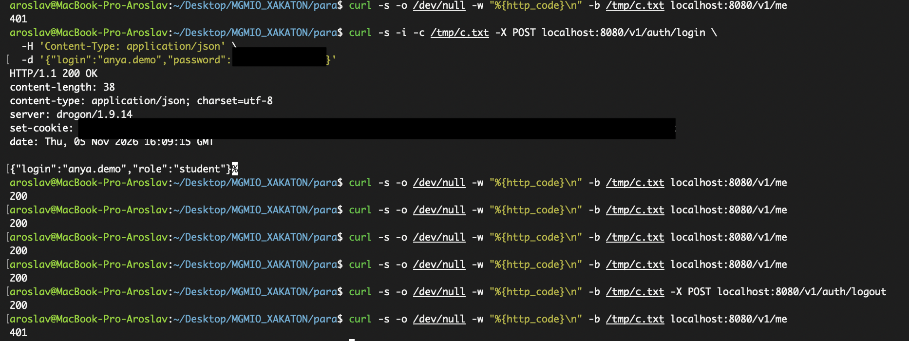

*Смок входа Э1: POST /v1/auth/login (anya.demo) → 200 с Set-Cookie para_session (HttpOnly; Secure; SameSite=Lax) и csrf; /v1/me по cookie → 200 — проверяем cookie-сессию и единый формат ошибок. — Э1 — вход, cookie-сессии*

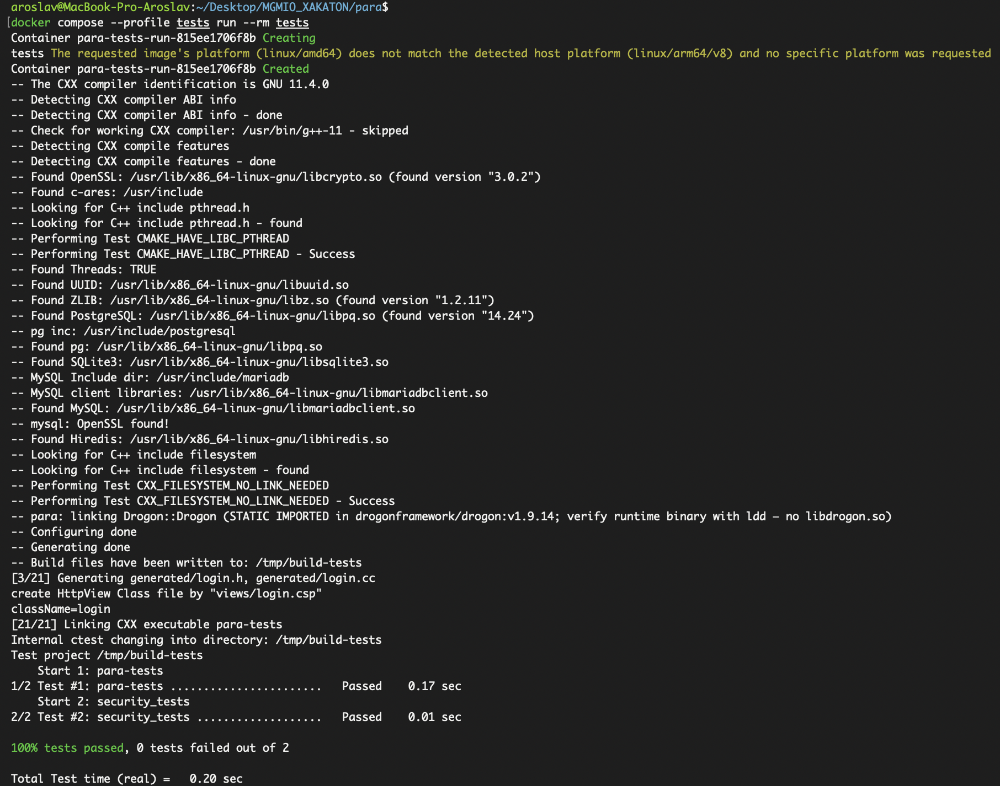

*Зелёный ctest гейта закрытия Э1 (05.11): docker compose --profile tests — para-tests + security_tests, 100% passed — проверяем, что контур собирается и тесты проходят. — Э1 — тесты/гейт*

### Э3–Э5а — ядро бэкенда: расписание, успеваемость, заявки, PDF, бронь (05–07.11)

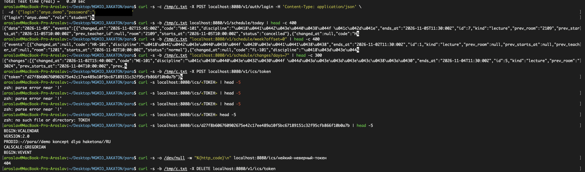

*Э3, API расписания и ICS-подписка: /v1/schedule/today|week|changes (перенос 3024→4210 «было → стало», cancelled) + цикл POST /v1/ics/token 201 → GET /ics/<токен> 200 text/calendar (10 VEVENT) → 404 после отзыва. — Э3 — расписание и ICS*

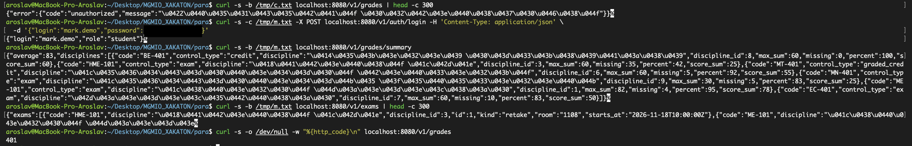

*Э4, успеваемость Марка: /v1/grades — 10 оценок, /grades/summary — average 83, «Мировая экономика» 78/82 (95%, до допуска не хватает 4), /exams — 3 события сессии по датам. — Э4 — успеваемость и сессия*

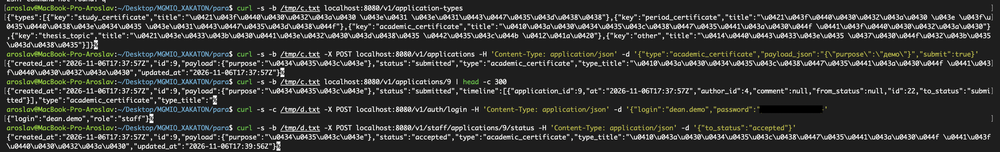

*Э5, жизненный цикл заявки: POST /v1/applications (Дина) → 201 submitted с событием таймлайна; staff-очередь dean.demo и переход accepted → уведомление автору с deep_link — проверяем автомат статусов и диалог студента/деканата. — Э5 — заявки на справки*

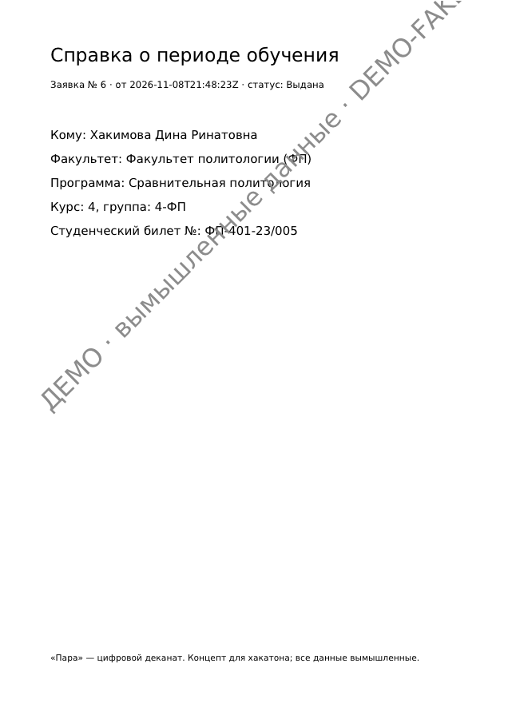

*Готовая PDF-справка Э5 (после фикса): %PDF с встроенным DejaVuSans — кириллица читается, потоки несжатые, штамп-маркер DEMO-FAKE-DATA о вымышленных данных; пара к скрину ui-bugs с битыми глифами. — Э5 — PDF-справка*

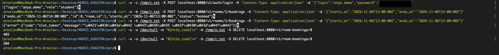

*Э5а, бронь аудиторий: сетка слотов /v1/rooms/1/slots на 06.11 — слот 11:00 booked (чужая бронь Олега), дубль слота другим студентом → 400 slot_taken — проверяем серверную проверку занятости и изоляцию «моих/чужих» броней. — Э5а — бронь аудиторий*

### Э6–Э6б — уведомления, люди, сервисы кампуса (07.11)

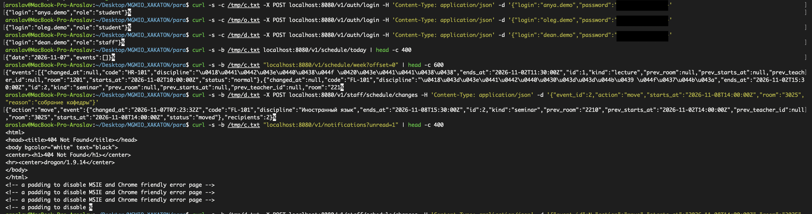

*КРАСНЫЙ скрин «до фикса» Э6: GET /v1/notifications отдаёт 404 — строки в БД пишутся (перенос создал 2 уведомления), а ленты нет; пробел закрыт отдельным коммитом eb88b44 (следующий скрин — «после»). — Э6 — уведомления (до фикса) — неудачная попытка / до исправления*

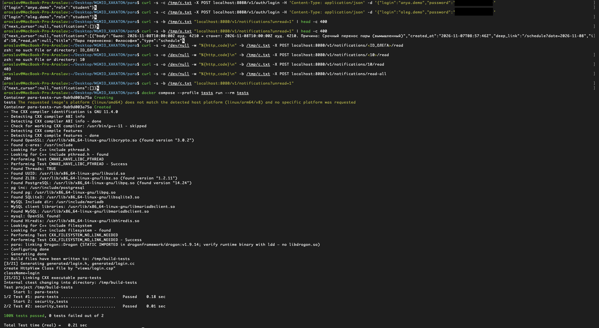

*Э6 «после фикса»: лента уведомлений Ани — 3 фикстурных уведомления новые сверху, unread/type-фильтры и курсор работают; внизу — зелёный ctest с юнит-кейсами ленты (111/111 на тот момент) — проверяем закрытие пробела коммитом eb88b44. — Э6 — уведомления (после фикса)*

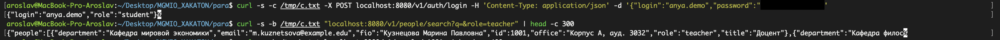

*Э6а, люди и приватность: /v1/people/search?q=Кузнецова&role=teacher — полный профиль преподавателя с кафедрой и кабинетом; чужие студенты при этом маскируются сервером в «И. Фамилия» (Р-15) — проверяем правило видимости. — Э6а — поиск людей*

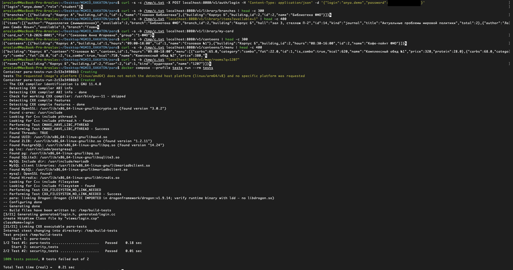

*Э6б, сервисы кампуса: /v1/library/items «свободно 2 из 3» + my-card, /v1/canteens/1/menu с КБЖУ и комбо, /v1/map/rooms?q=1207 → Корпус Б, этаж 2 — проверяем каталог библиотеки, столовые и поиск кабинета по карте. — Э6б — библиотека, столовая, карта*

### 5.17 — новости и события (12.11)

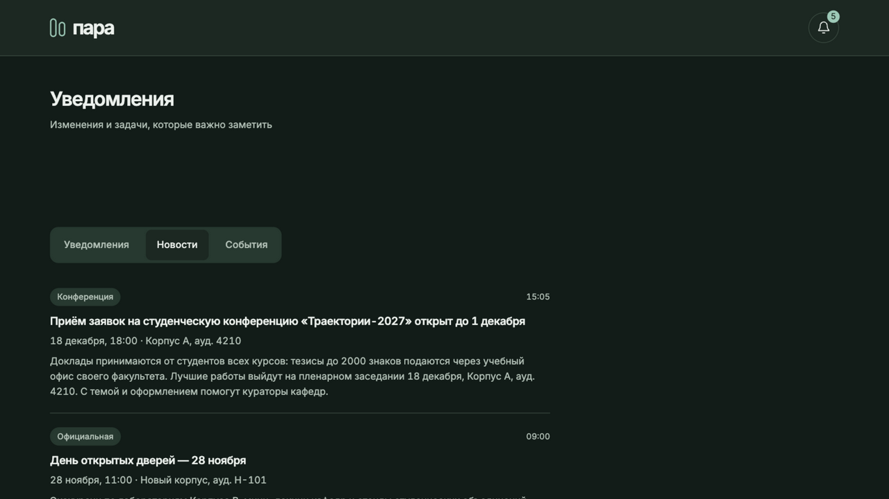

*Новости и события (5.17): лента новостей после публикации через staff-форму — категории (official/conference/org/event), аудитория all/group/course, новые сверху — проверяем видимость по аудитории сессии. — 5.17 — новости и события*

### 5.18 — мультиязычный UI ru/en/中文 (12.11)

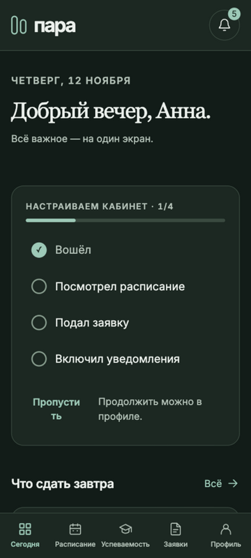

*Мультиязычность (5.18), русский: экран «Сегодня» с ru-словарём (332 ключа × ru/en/zh, рендер SSR по языку профиля) — базовый экран для сравнения трёх языков. — 5.18 — мультиязычный UI (ru; вёрстка до редизайна v3)*

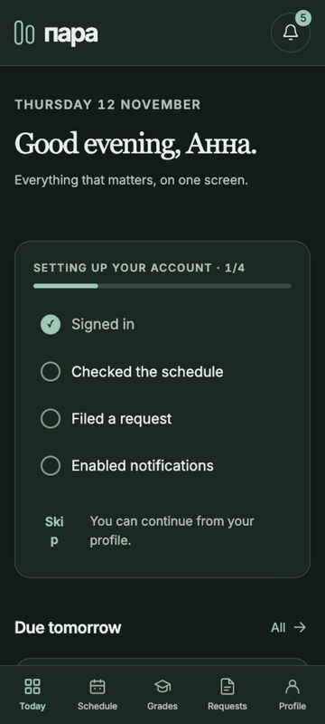

*Мультиязычность (5.18), английский: тот же экран «Сегодня» после переключения языка в футере — проверяем, что переводится весь UI, включая данные и навигацию. — 5.18 — мультиязычный UI (en; вёрстка до редизайна v3)*

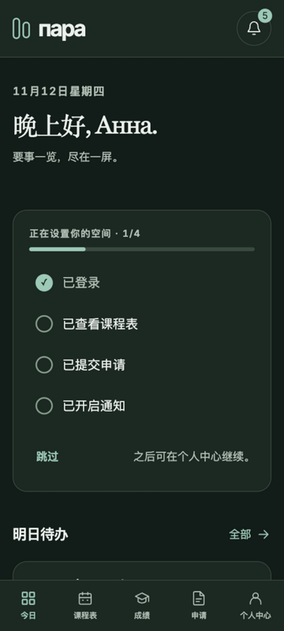

*Мультиязычность (5.18), китайский: экран «Сегодня» на 中文 — проверяем третьку словаря и работу CJK-строк в вёрстке 360 px без поломок. — 5.18 — мультиязычный UI (中文; вёрстка до редизайна v3)*

### Дизайн v3 — перенос 41-страничного эталона (18–19.11)

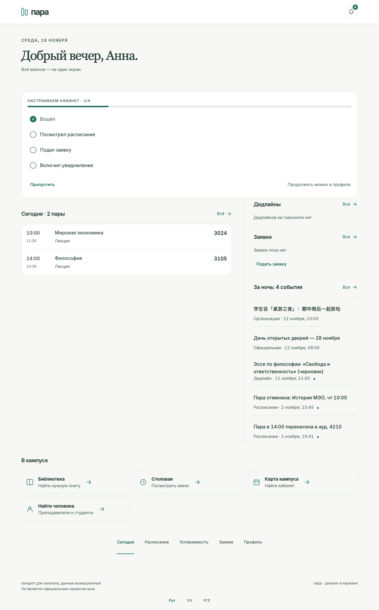

*Дизайн v3 «до»: экран «Сегодня» в старой вёрстке до переноса эталона design-drafts/v3 (41 страница) — точка отсчёта для сравнения с «после». — Дизайн v3 — до переноса — неудачная попытка / до исправления*

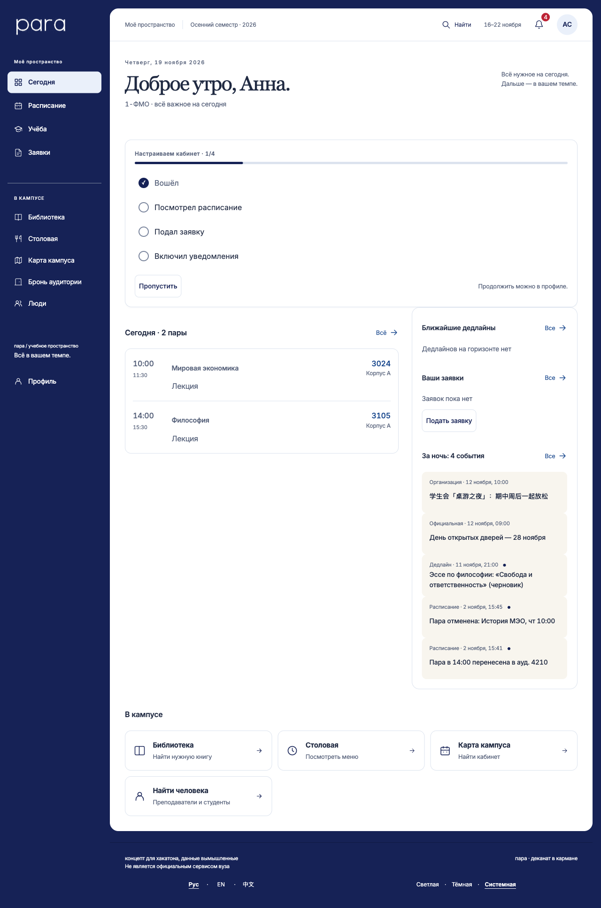

*Дизайн v3 «после»: тот же экран «Сегодня» на разметке эталона — navy-токены, каркас с вордмарком, primary-nav/таб-баром, быстрым поиском и футером с языком и темой; ctest ветки 175/175 + contrast_check FAIL 0. — Дизайн v3 — после переноса*

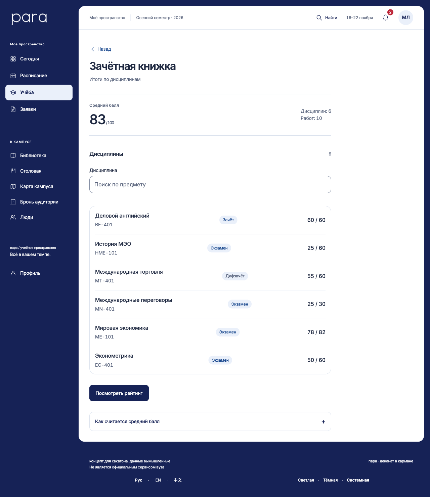

*Зачётка (5.15, Э6а) в дизайне v3: агрегат по дисциплинам из /v1/gradebook — average 83, ME-101 78/82 → 95%, счётчики дисциплин/работ — проверяем агрегирование оценок и пустое состояние для Ани. — Э6а/5.15 — зачётка (дизайн v3)*

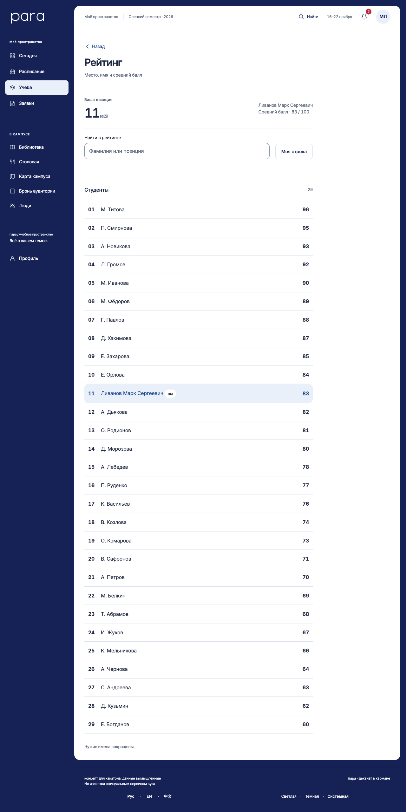

*Рейтинг факультета (Э6а) в дизайне v3: своя строка с полным ФИО и rank, чужие — маскированные «И. Фамилия» (маскирование на сервере, Р-15) — проверяем, что полное ФИО чужих из API не утекает. — Э6а — рейтинг (дизайн v3)*

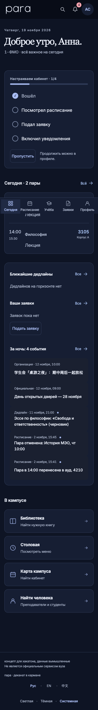

*Mobile-first и тёмная тема: экран «Сегодня» на 360 px в dark-режиме дизайн-системы v3 — проверяем вёрстку от 360 px и токены тёмной темы (contrast_check FAIL 0). — Дизайн v3 — 360 px + тёмная тема*

### 5.19 — ИИ-ассистент (20–21.11)

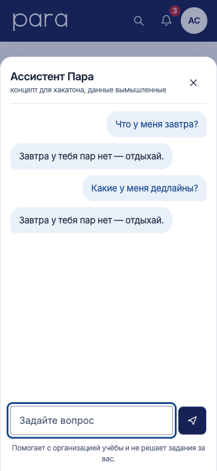

*ИИ-ассистент (5.19): ответ ассистента в плавающем чате на 360 px — YandexGPT по контексту только своих данных (расписание/дедлайны/заявки); проверяем состояния чата и лимиты (429 при 10 сообщ/мин). — 5.19 — ИИ-ассистент*

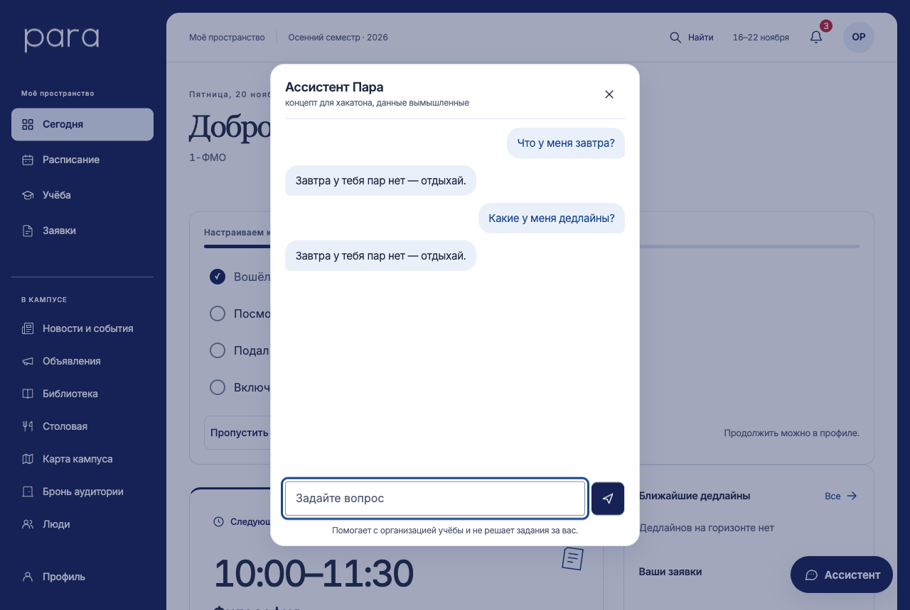

*История чата ассистента (5.19) на desktop: GET /v1/assistant/history — последние 20 своих реплик, тёмная тема — проверяем сохранение пары «вопрос–ответ» только при успехе и изоляцию по сессии. — 5.19 — ИИ-ассистент (история)*

### Дефект 21.11 «пустые Новости» — до и после

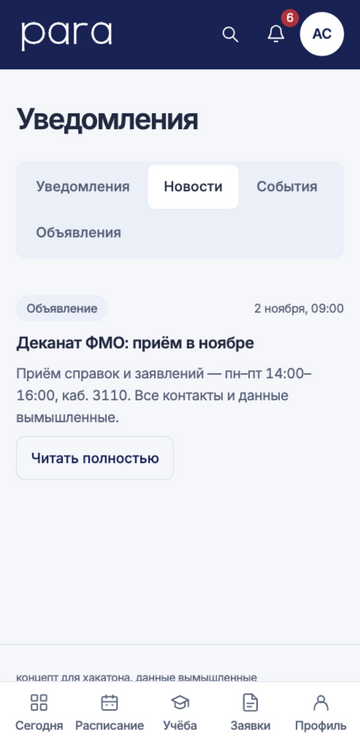

*Дефект 21.11 «до»: лента «Новости» пустая — том демо-контура засеян до news-блока фикстур (news=0), при этом клиент a121e83 исправен (curl + браузер) — проверяем диагностику устаревшего сида по дампу БД. — Дефект 21.11 — пустые новости (до) — неудачная попытка / до исправления*

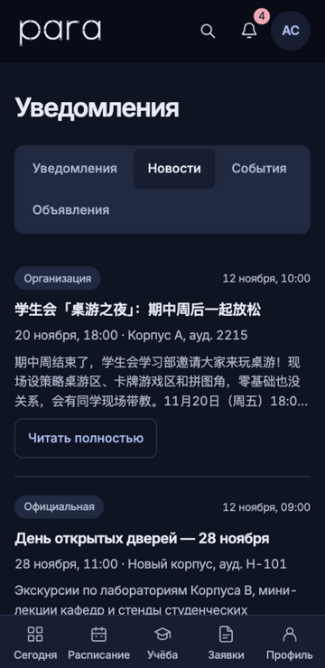

*Дефект 21.11 «после»: после пересева контура (down -v + up) и детекции устаревшего сида по отпечатку fixtures-digest лента «Новости» наполнилась — news=9, «События» 7 — проверяем, что фикс MigrationRunner предупреждает о stale-сиде. — Дефект 21.11 — пустые новости (после)*

### ui-bugs — найденный дефект вёрстки

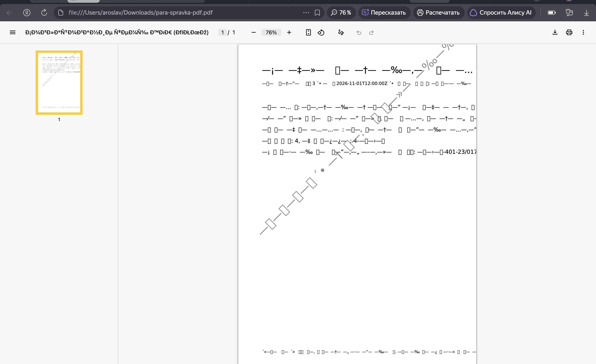

*UI-баг «неудачная попытка»: превью PDF-справки с нечитаемыми глифами — кириллица без встроенного шрифта (до подключения DejaVuSans через libharu /FontFile2) — «до» к зелёному скрину pdf-readable.png. — ui-bugs — найденные дефекты вёрстки — неудачная попытка / до исправления*

## §5. Вход, хранение данных и защита

Простыми словами — как устроена защита и где что хранится (docs/02-техническое-решение.md §6, AGENTS.md §4 и §6-Э8; живые проверки — ниже).

- **Пароли.** В базе — только хэши Argon2id с параметрами OWASP (t=2, m=19 456 КБ, p=1; библиотека phc-winner-argon2), пароль из хэша не восстановить; сверка constant-time (02 §6.2). Значение единого демо-пароля в репозитории и БД не живёт — публикуется в комментарии к работе; ротация хэшей — 42ab5a1 (Р-9).
- **Сессии.** Не JWT: вход создаёт случайный токен в cookie (HttpOnly; Secure; SameSite=Lax) и строку в таблице sessions. Рестарт сервера сессии жюри не убивает; «Выйти» — удаление строки на сервере (02 §6.1).
- **Изоляция «подставить адрес не выйдет».** Три уровня: LoginFilter на всех приватных роутах (без сессии — 401/303), запросы скоупом WHERE user_id и OwnershipGuard — одна функция, проверяющая владение по id из пути ДО отдачи данных: чужой существующий объект → 403 «Доступ только к своим данным», несуществующий → 404, ошибка БД → fail-closed (02 §6.3; AGENTS.md §3). Свойство сервера, а не скрытие ссылок в интерфейсе.
- **CSRF.** Double-submit: приватные POST/PUT/DELETE требуют cookie csrf + заголовок X-CSRF-Token (или поле _csrf) — с Э8 (Р-23); GET и сам вход — без токена; расхождение → 403 csrf.
- **Заголовки ответов.** CSP default-src 'self' (без внешних CDN), X-Frame-Options: DENY, nosniff, Referrer-Policy (Э8 шаг 3) — живой сайт отдаёт их все (curl в этой сессии 21.11).
- **TLS.** Let's Encrypt на Nginx, HTTP→HTTPS 301, cookie Secure; сертификат CN=para-student.ru выдан 14.11.2026 (openssl, проверено 21.11 — факт-база; https://para-student.ru/healthz → 200 «ok» — curl этой сессии).
- **Секреты.** Только в переменных окружения сервера: .env в .gitignore/.dockerignore, в репо — env.example без значений; ключи ассистента — ASSISTANT_* в .env (Р-36); логи без паролей и токенов (Э8 шаг 6, e5cdcf4).
- **Security-тест.** security_tests.cpp — полный HTTP-вариант автотеста 02 §9.3 (шаги 1–8, живые cookie-сессии, FAIL валит прогон exit 1): 403 на чужие заявку/оценку/уведомление/бронь, 404 на несуществующие, 401 без cookie, 403 студенту на staff. Счётчики — security_tests 119/119 («шаги 1–8 ПРОЙДЕН»), para-tests 189/8333 (AGENTS.md §6, 21.11; a5ef91c, e2e5204).
- **Прочее.** Rate-limit входа: 3 неудачи → 15 с с удвоением до 15 минут (429 + Retry-After); ассистент — 10 сообщений/мин; SQL параметризован; XSS — экранирование до вставки в CSP-шаблоны (Р-16).

## §6. Ручные этапы и вклад человека

Команда — один человек: Ермаков Ярослав (github: vertaler3) — продукт, бэкенд, сервер, оркестрация агентов, приёмка (ответ владельца, п.3).

За человеком — решения, которые агенты не принимали: стек C++20/Drogon (02 §2), состав и приоритеты фич (расширение 5.11–5.16 — Р-10, 05.11; срезы «+0.4» и откладывание web-push — Р-30, 13.11), очередь этапов (05 §3). Сервер — руками владельца: VPS арендован им (Р-30); руками же — часть правок кода/вёрстки (19.11: 10 правок + ревью checker, Р-35 — журнал 2026-11-19-фиксы-владельца.md); деплой Э9 выполнен без журнала агента, фактическое подтверждение — живой сайт и TLS-сертификат Let's Encrypt CN=para-student.ru от 14.11.2026. Что увидит жюри при воспроизведении из репозитория (clone main, затем `docker compose up -d --build`): полный работающий контур со всеми обязательными фичами и всеми фиксами 21.11 — ветка ассистента слита в main (PR #6, 21.11), включая детекцию устаревшего сида и предфильтр арифметики/переводов; дефект «пустые новости» не воспроизведётся — news-блок в fixtures.sql на месте, свежий том сеет news=9.

Приёмка — человеческая: гейт этапа — внешний скрипт владельца (агент compose не гоняет — AGENTS.md §6, записи Э2–Э6б); владелец же пишет гейт-скрипты и промпты-постановки для агентов: журнал 3.1 называет это «промптом оркестратора», журнал дизайн-v3 — «промптом владельца». Шесть циклов гейтов дали самые поучительные эпизоды проекта: ложные тревоги на старых бинарях (Э3-р2, Э5-р2, Э6-р2 — гейт проверял образ, собранный до фикса; ответ — «пробы свежести» /Subject para-e5-gate-r2 и X-Para-Round: e6-gate-r2, а не слепые правки), дефект гейт-скрипта Э6б-р2 (countOf получал ключ уже в кавычках → regex `""id""` → всегда 0; признан владельцем по эскалации) и «дельты 0» ночью — корректная работа тихих часов 23:00–07:00 (разбор Э6, AGENTS.md §6). Эскалации Э5а-р2 и Э6б-р2 раскрыли скрытые критерии проверок гейта. Ручными остались «ICS в календаре телефона» и webcal:// (не воспроизводимы в контейнере — план Э10, Р-30, AGENTS.md §8), вход демо-аккаунтами и 403-тест на проде (05 §3), живой аудит ассистента — 17 вопросов живому чату 20–21.11, давший фиксы промта и сборщика контекста (журнал 2026-11-21-ассистент-фиксы.md); дефект «пустые Новости» пойман на живом томе 21.11 и закрыт детекцией fixtures-digest (a5ef91c).

Время: ~40 часов владельца за 2,5 недели (4–21.11, вечера и ночи, почти каждый день) против ~80 часов автономной работы агентов — оценка владельца (п.5). Про «ошибки ИИ» (п.4): грубых кодовых ошибок не было — недопонимание запросов, ловившееся на приёмке и исправлявшееся фиксами.

## §7. Сравнение «обязательный пул задания ↔ что построено»

Обязательный пул — ядро строк 29–33 задания (цитата в 05 §1), требования к прототипу (01 §17, 05 §1) и обязательные разделы 5.17/5.18/5.19. Ядро — этапы Э1–Э6 (AGENTS.md §6), API — 02 §5.2, сценарии С1–С8 — 01 §3.

**Что построено — для чтения без репозитория.** Монолит C++20 на Drogon v1.9.14: тонкие контроллеры, логика в src/services, серверный рендер на CSP-шаблонах; SQLite (WAL) с миграциями 0001–0009 и демо-фикстурами при старте; фронтенд — CSS на токенах, вендоренные htmx/Alpine.js, без npm-сборки и внешних CDN (02 §2–§3; AGENTS.md §3). Топология: один российский VPS, Nginx с TLS (виден в ответах живого сайта) перед приложением в Docker multi-stage, данные — том с SQLite (02 §8). Запуск: `docker compose up -d --build` → :8080, живость — /healthz, тесты — `docker compose --profile tests run --rm tests`. Репозиторий https://github.com/vertaler3/para (публичный), лицензия MIT. Демо-доступы (05 §6): anya.demo — первокурсница (онбординг «4 шага», пустая успеваемость), oleg.demo — одногруппник (изоляция при общей группе), mark.demo — 4 курс (дедлайны, ICS-подписка), dina.demo — заявка «в работе» с таймлайном, dean.demo — сотрудник деканата (очередь, перенос, публикация); единый демо-пароль — в комментарии к работе, на экране входа подставляется тапом.

| Требование задания | Как реализовано (источник) |
|---|---|
| **Ядро: вход и профиль** | Вход с cookie-сессиями (sessions в БД), rate-limit 3→15 с удвоением, /v1/me, настройки: тема, тихие часы, язык (Э1–Э2) |
| **Ядро: расписание** | today·week·changes с «было → стало», prev-аудитории и корпусами (Э3, э7-be); ICS-подписка: токен 256 бит, ротация, GET-статус (Р-11/Р-25/Р-29) |
| **Ядро: успеваемость** | /v1/grades, /grades/summary («до допуска не хватает 4», average 83), /v1/exams, пустое состояние первокурсника (С5.6); зачётка 5.15 (Э4, Э6а) |
| **Ядро: заявки и справки** | Автомат 16 переходов + таймлайн + мини-диалог need_info с возвратом «В работе» (С7.6), staff-очередь с «горит», PDF-справка со штампом «ДЕМО · вымышленные данные · DEMO-FAKE-DATA» (Э5; 3.4–3.6) |
| **Ядро: уведомления** | WebSocket /ws, лента с курсорной пагинацией, тумблеры и тихие часы, утренний дайджест, «Изменения недели», deep_link (Э6); объявления — отдельно от новостей (01 §4.5) |
| Только вымышленные данные; бейдж «Это концепт для хакатона…» | Все фикстуры вымышленные; бейдж на входе и в подвале всех экранов (AGENTS.md §5.1); штамп и машинный маркер в PDF (Р-12) |
| Без логотипа вуза | Собственный вордмарк «Пара» (01:7; дизайн v3) |
| Пароли — только хэши | Argon2id t=2 m=19456 p=1 (OWASP), в БД только encoded-строки (02 §6.2; §5 отчёта) |
| Ключи сервисов — только на сервере | .env вне git, env.example без значений, ASSISTANT_* (02 §6.5, Р-36) |
| Каждый студент видит только свои данные (задание, строки 48–51 — по цитате в 02 §6.3) | LoginFilter + WHERE user_id + OwnershipGuard (403/404, fail-closed) — автотест 02 §9.3 шаги 1–8 = security_tests 119/119 |
| Доступен из России без VPN до 28.11 (итоги 28.11) | Российский VPS без внешних CDN (02 §2.3, §8.4); /healthz → 200, LE-сертификат от 14.11 (curl этой сессии). Полевая проверка «из РФ без VPN» не проводилась — план Э10 (Р-30; §6) |
| Mobile-first от 360 px | 360 px + десктоп, тёмная тема, contrast_check FAIL 0, WCAG ≥ 4.5:1 (01:17; 02 §2.3; скриншоты §4) |
| Исходники с лицензией MIT | LICENSE в корне репозитория (05 §2; «строка 47 задания» — по цитате в 05) |
| Обязательная фича: новости и события (5.17) | Лента /v1/news с курсорной пагинацией, адресация all/group/course, staff-публикация kind=news, 9 фикстурных новостей включая китайскую (12.11; 3.13) |
| Обязательная фича: мультиязычность ru/en (5.18) | Серверный словарь: инвентаризация 253 ключа, итоговый словарь шага 332 ×3, после v3 — 843; cookie para_lang → Accept-Language → ru, CJK font-fallback, тесты i18n (12.11, 19.11) |
| Обязательная фича: ИИ-ассистент (5.19) | YandexGPT по OpenAI-совместимому API, контекст только своих данных, история 20 реплик, лимиты; живой ответ 20.11 (потребовались роль ai.languageModels.user и привязанный платёжный аккаунт — иначе 403); фиксы по живому аудиту 21.11 — промт, контекст, даты вопросов и детерминированный отказ на арифметику/переводы до вызова модели (Р-36) |

**Сверх обязательного** (реестр идей 01 §5; статус — AGENTS.md §6 + git log): экран «Сейчас важно»/«Сегодня» (5.1); дедлайн-радар (5.2); справка за 3 касания (5.3); ICS-подписка (5.4); WebSocket-push — web-push отложен владельцем до после подачи, до того гарантия доставки WS (5.5, Р-30); тёмная тема и тихие часы (5.6, Р-31); настраиваемый дашборд — частично (5.7); импорт из открытых данных — не реализован, точечно взяли имена корпусов (5.8, Р-22); QR-карточка (5.9). Сервисы кампуса: бронь с блокировкой деканатом (5.10, Э5а); профили людей с маскированием «И. Фамилия» на сервере (5.11, Э6а, Р-15); библиотека с наличием и билетом (5.12, Э6б); столовая с ценами/КБЖУ/комбо (5.13, Э6б); рейтинг — только студенты со средним (5.14, Э6а); зачётка (5.15, Э6а); карта с поиском кабинета и SVG-схемой (5.16, Э6б; Р-32). Сверх реестра: PDF-маркеры DEMO-FAKE-DATA, единый OwnershipGuard, CSRF double-submit, ротация ICS-токенов, детекция устаревшего сида, поиск Ctrl/⌘+K, страница 404 v3 (AGENTS.md §6, 19.11). Тесты по этапам: 16/219 (Э2) → 111/3272 (Э6) → 151/3916 (Э6б) → 155/3931 (5.17) → 167/5645 (5.18) → 175/7916 (v3) → 189/8333 + security 119/119 (21.11, AGENTS.md §6).

**Агенты ↔ вручную:**

| Делали ИИ-агенты | Только человек |
|---|---|
| Пакет решений 01–05 и планирование этапов (ZCode/GLM; AGENTS.md §6) | Продуктовые решения и приоритеты: стек, расширение 5.11–5.16, срез «+0.4», откладывание web-push (Р-30) |
| Почти весь код: бэкенд Э1–Э6б и э7-be, вёрстка Батчей 1–4, дизайн-эталон v3 (GPT, 14–17.11), перенос fe_rebuild (Claude, 18–19.11), 5.17/5.18/5.19, фикстуры v2 | Аренда VPS, домен, TLS, деплой и живой контур (Р-30; Э9 без журнала агента); ручные правки кода/вёрстки 19.11 (Р-35, журнал 2026-11-19-фиксы-владельца.md) |
| Тесты: para-tests 187/8300, security_tests 119/119, contrast_check FAIL 0 (AGENTS.md §6) | Запуск приёмочных гейтов (down -v → up --build + чек-скрипты) и эскалации по критериям (Э5а-р2, Э6б-р2) |
| Журналы docs/agents-log (89 файлов), записи решений Р-1…Р-36 | Утверждение решений; мержи PR #1–#6 (git log --merges); демо-пароль и перевыпуск ключа YandexGPT (§5.2, AGENTS.md §8) |
| Диагностика по сводкам гейта: старые бинари, \uXXXX, stale-сид новостей | Мобильная приёмка и живые проверки (Э10: ICS на устройстве, доступность из РФ), живой аудит ассистента — 17 вопросов |

## Заключение

За 2,5 недели (4–21.11.2026) один человек с конвейером ИИ-агентов трёх семейств (GLM в ZCode, GPT, Claude) прошёл от пустой папки до задеплоенного демо-прототипа (данные вымышленные): обязательное ядро деканата, три обязательные фичи задания, семь сервисов кампуса (5.10–5.16) и фишки 5.1–5.9 сверх ядра, 187 юнит-кейсов на 8300 утверждений плюс 119 security-проверок и живой сайт на https://para-student.ru (проверено curl'ом 21.11). Формула процесса: агентам дают фиксированные контракты вместо права выдумывать API; каждая сессия заканчивается коммитом, журналом и тестами; человек ставит задачи, гоняет внешний гейт и разбирает каждую красную сводку — поэтому даже ложные тревоги превращались в «пробы свежести», а не в слепые правки. Главный урок: недопонимание между постановкой, гейт-скриптом и API — рабочая ситуация, если оно ловится приёмкой и фиксируется в журнале дословно.

*Отчёт собран ИИ-агентами (ZCode, workflow) под редакцией владельца.*
